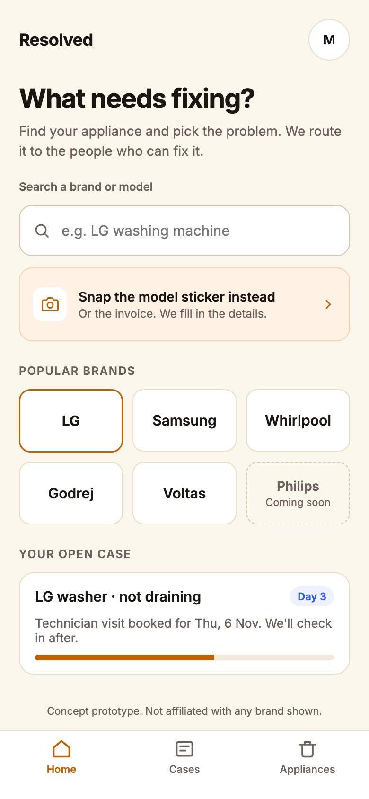
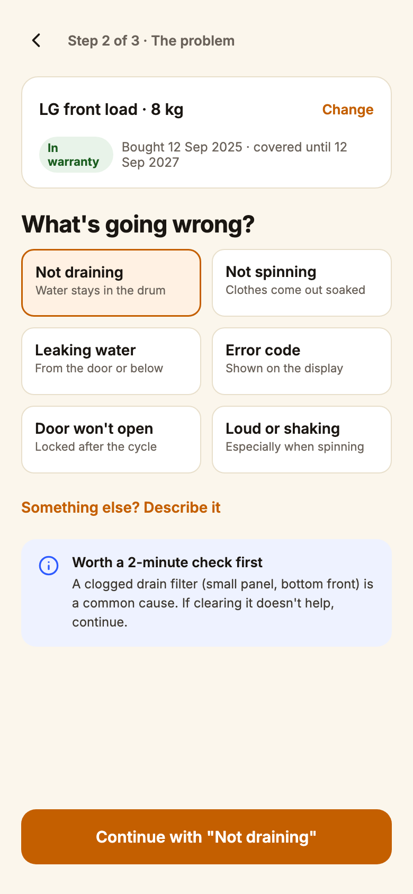
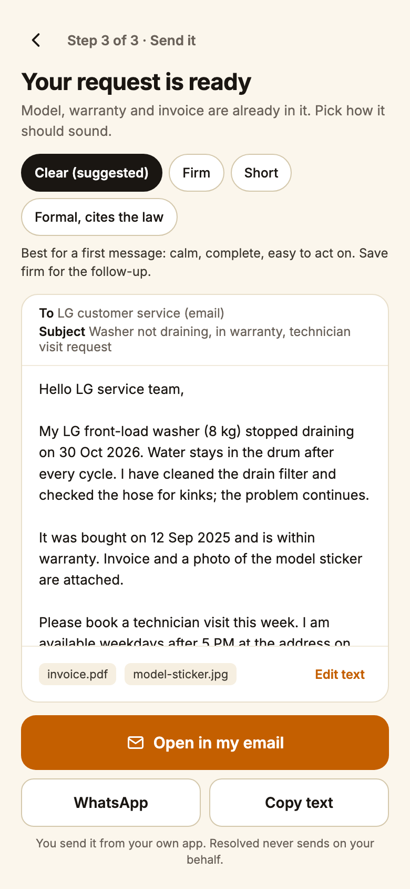
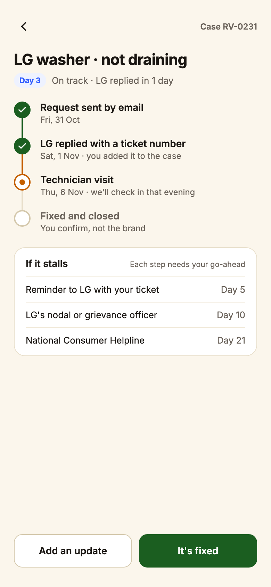
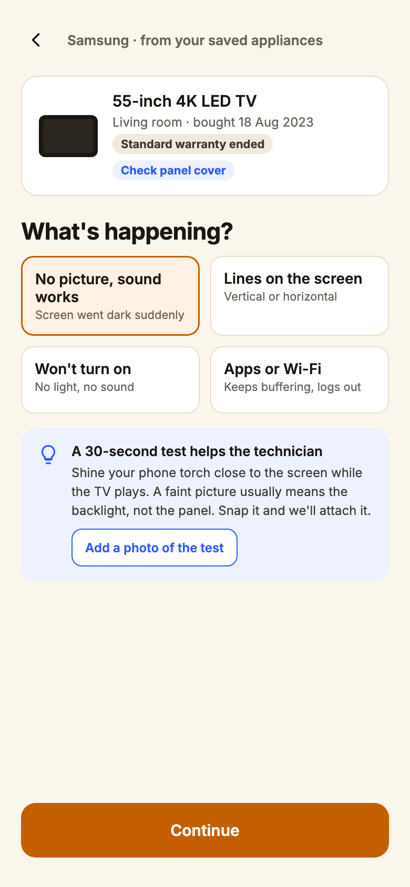
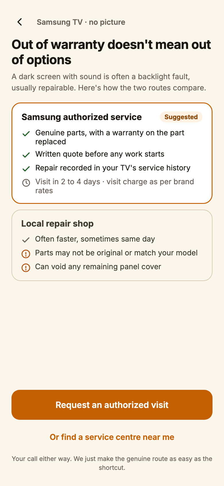
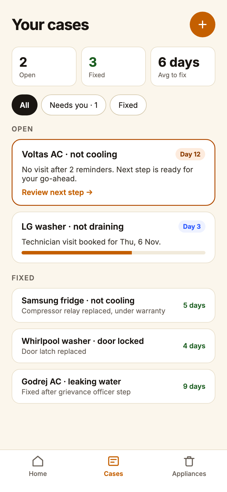
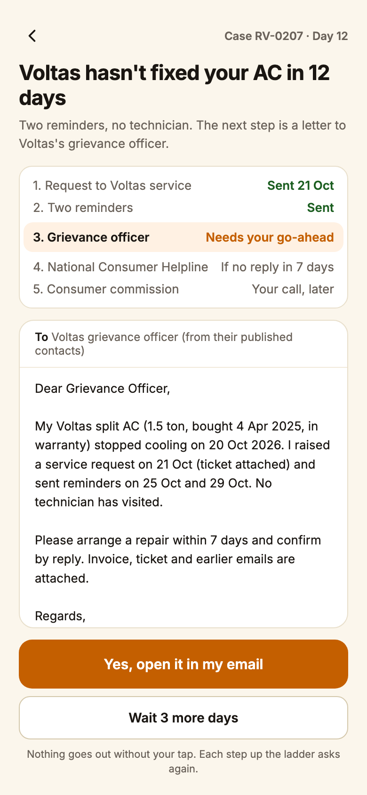
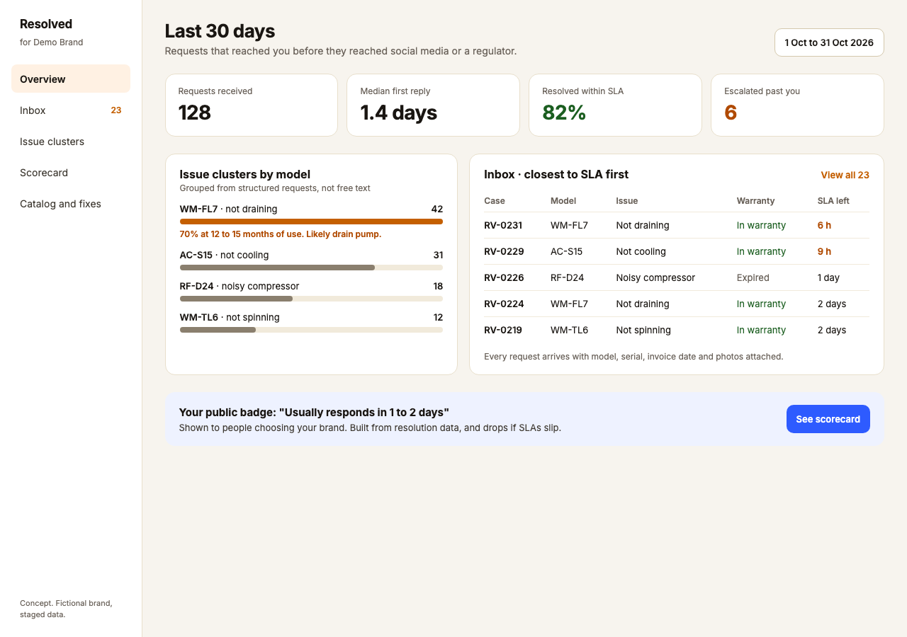

# Resolved

**Appliance broke? Get it to the people who can actually fix it.**

Resolved helps people in India get a washing machine, AC, fridge or TV repaired through the brand's own service network, without hunting for the right number or explaining the model three times. You pick the brand, the model and what's wrong. Resolved hands you a complete request (model, serial, invoice date, warranty status, what you've already tried) and routes it to the right channel. If the brand goes quiet, it walks you up the escalation ladder, one approved step at a time.

This repo holds two versions of the idea. v1 was a complaint-fighting agent, built as a React app. v2 is where the product is going: a PRD, plus a clickable web prototype in [`prototype/`](prototype/).

- **v2 PRD:** [Resolved v2 — PRD](https://claude.ai/artifact/6ijsxYyqwnihhsWxXCXHyj)
- **v2 prototype:** 12 clickable screens covering two consumer journeys, case tracking, escalation and the brand console ([run it locally](#run-the-v2-prototype))

<p align="center">
  
  
  
  
</p>
<p align="center"><sub>Journey A · LG washer not draining, in warranty: home → issue → drafted request → tracking</sub></p>

---

## Why v2 exists

v1 assumed the enemy was the support bot. Building it, I kept running into a different problem: for appliances, people mostly don't need a lawyer-ish letter. They need to reach the authorized service centre, with the right facts, before they give up and call a local repair guy.

That shortcut has a cost. Out of warranty especially, people end up with neighbourhood shops or app-based repair services that are quick to book but may fit non-original parts, void what's left of a panel warranty, and leave no service record. The brand loses the customer, the parts revenue and the defect signal. People don't pick that route because they prefer it. They pick it because the authorized path is hard to find and slow to start.

And every durable goes through the same loop: raise a ticket, a technician visits, diagnosis, part, repair, close. Standardise the front of that loop and one product works across every brand.

## How v2 works

**For the consumer**

1. Search a brand, or snap the model sticker or invoice.
2. Confirm the facts and see the warranty status.
3. Pick the problem from a short, plain-language list ("not draining", "no picture, sound works").
4. Get a drafted request in the tone you want (clear, firm, short, or formal with the legal citation), and send it from your own email or WhatsApp. Resolved never sends on your behalf.
5. Track it. If the brand misses its window, the next rung (reminder → nodal or grievance officer → National Consumer Helpline) is drafted and waits for your go-ahead.

<p align="center">
  
  
  
  
</p>
<p align="center"><sub>Journey B · Samsung TV out of warranty, where people drift to unverified repair · plus the cases list and an escalation waiting for consent</sub></p>

**For the brand**

<p align="center">
  
</p>

Every brand is listed from day one using public channels. Brands that opt in get requests first, as structured tickets in their own queue, plus issue clusters by model ("42 requests for WM-FL7 not draining, mostly at 12 to 15 months") and a public "usually responds in X days" badge built from real resolution data. Brands pay for the console. Consumers never pay.

**Where AI fits, and where it doesn't**

Routing, templates and legal wording are structured data, because they need to be right every time and they cost nothing to run. AI is used where text input is genuinely worse: reading a photo of a model sticker or invoice, mapping a free-text "something else" problem to a known issue, and clustering defects for brands.

---

## v1: what's in this repo

v1 is a React prototype of the earlier idea: an agent that fights back when companies use AI to stall complaints.

<p align="center">
  
  
</p>

The flow: capture evidence → extracted facts (with partial and could-not-read states) → strategy (tone, legal hook, demand) → four output formats (letter, tweet, call script, court filing) with reword, copy and share → a five-rung escalation ladder where every step needs explicit consent, with an opt-in auto-pilot → a dashboard of cases.

Being straight about what it is:

- **All data is staged.** One sample case runs through the whole flow. There are no live model calls in this code.
- **Progress survives a refresh** (saved in the browser). No backend, no accounts.
- **Nothing is sent anywhere.** Filing, posting and calling are simulated.

React 18 + Vite, a hand-built light/dark design system on CSS custom properties, no UI library.

### Run the v2 prototype

Plain HTML, nothing to install:

```bash
python3 -m http.server 5180 --directory prototype
```

Open `http://localhost:5180/screens.html` for every screen by journey, or start at `http://localhost:5180/` and tap through.

### Run v1 locally

```bash
npm install
npm run dev
```

Open `http://localhost:5173`. No API key needed.

---

Built by [Arthi Vinod](https://arthivinod.github.io/myWebsite/), product manager working on AI products.
